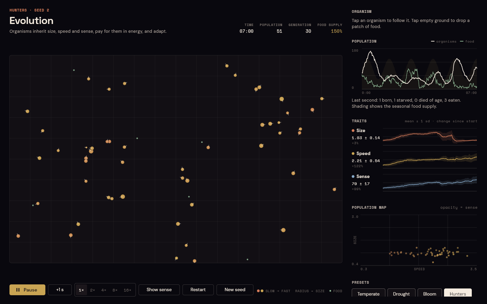
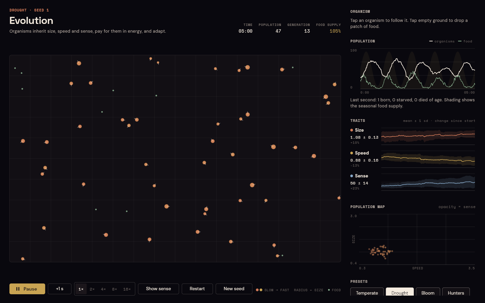

# Evolution

A natural selection sandbox built with Flutter. A population of simple organisms inherits three traits (size, speed and sense), pays for them in energy, and adapts to the food supply, the seasons and, if you turn them on, predators. Nothing is scripted. Every trend in the charts comes from who survives long enough to reproduce.

**[Open the live demo](https://chams99.github.io/Evolution/)**. It runs in the browser, with no install.



## What you can do

- **Watch traits shift.** Each trait shows its mean and spread over the whole run. Population is plotted against food, with the seasonal supply shaded behind it, and a size-speed map shows every living organism.
- **Follow one organism.** Tap it to see its energy, age, genome, offspring, kills and, eventually, how it died. Tap empty ground to drop a patch of food.
- **Compare environments.** Four presets push selection in different directions (see below).
- **Run experiments.** Change food rate, food energy, seasons, mutation strength, lifespan and predation, then restart. The same seed always replays the same run.
- **Control time.** Play at 1× to 16×, or step one simulated second at a time. Keyboard: `Space` plays or pauses, `→` steps, `R` restarts.
- **Take the data with you.** Copy the full history as CSV, with one row per simulated second.
- **Share a run.** `?preset=hunters&seed=3&at=240` opens Hunters with seed 3, already four minutes in.

## The model

On every tick, each organism:

1. **Looks around** within its sense radius. If predation is on and something at least 1.3× its size is nearby, it turns away. Otherwise it turns toward the closest food (or smaller organism), or wanders.
2. **Moves** at its speed, turning at most 0.3 rad per tick.
3. **Pays energy**: `basal · size² + move · size² · speed² + sense · radius`.
4. **Splits in two** when its energy reaches `150 · size²`. The child takes half the energy and a copy of the genome with independent Gaussian mutations (7% standard deviation by default).
5. **Dies** when it runs out of energy, reaches its lifespan, or is eaten.

Bodies below size 1 can only digest part of each food item. Without that rule, shrinking would always win. Food appears at a rate that rises and falls with a sine-wave season.

| Trait | Helps | Costs |
| --- | --- | --- |
| Size | Digests whole meals, stores more, can eat organisms 1.3× smaller | Every movement costs more, and reproduction needs more energy |
| Speed | Reaches food first, outruns predators | Cost grows with the square of speed |
| Sense | Finds food and threats from further away | A constant drain, proportional to radius |

### What the presets do

These results come from [`tool/balance.dart`](tool/balance.dart): 10 simulated minutes, seeds 1 to 3.

| Preset | Setup | Typical outcome |
| --- | --- | --- |
| Temperate | Steady food, mild seasons | Size stays near 1, speed and sense creep up |
| Drought | Scarce food, harsh dry spells | Numbers crash every season, speed stays low |
| Bloom | Plenty of food | The largest populations, and the fastest rise in speed |
| Hunters | Predation on | Size, speed and sense escalate together |



## How it is built

```
lib/
  sim/            The simulation, in plain Dart with no Flutter imports
    world.dart        Rules: sensing, movement, metabolism, reproduction, death
    genome.dart       Traits, limits and mutation
    spatial_grid.dart Bucket grid for neighbour queries
    rng.dart          Seeded random source, so every run can be replayed
    sample.dart       Per-second statistics and CSV export
  app/            The interface
    lab_controller.dart  Runs the world on a fixed timestep tied to the frame ticker
    lab_screen.dart      Side-by-side layout on wide screens, tabs on phones
    widgets/             Field and chart painters, panels
test/
  sim/            Determinism, bounds, food, births, predation, seasons, CSV
  app/            Layouts at phone, tablet and desktop sizes; controls and taps
tool/balance.dart Headless runner used to tune the energy model
```

The engine never imports Flutter, so the tests, the balance tool and the app all run exactly the same rules. The UI repaints the field from a `ValueNotifier` on every frame, and redraws the charts only when a new sample arrives, once per simulated second. Ten simulated minutes run headless in one to four seconds, depending on population size.

## Run it locally

Requires Flutter 3.41 or newer.

```sh
flutter pub get
flutter run -d chrome        # or any connected device
flutter test
dart run tool/balance.dart   # optional: preset outcomes over 600 simulated seconds
```

## Credits

Space Grotesk, DM Sans and Space Mono are used under the SIL Open Font License. The licence texts are in [`assets/fonts`](assets/fonts).

Released under the [MIT License](LICENSE).
