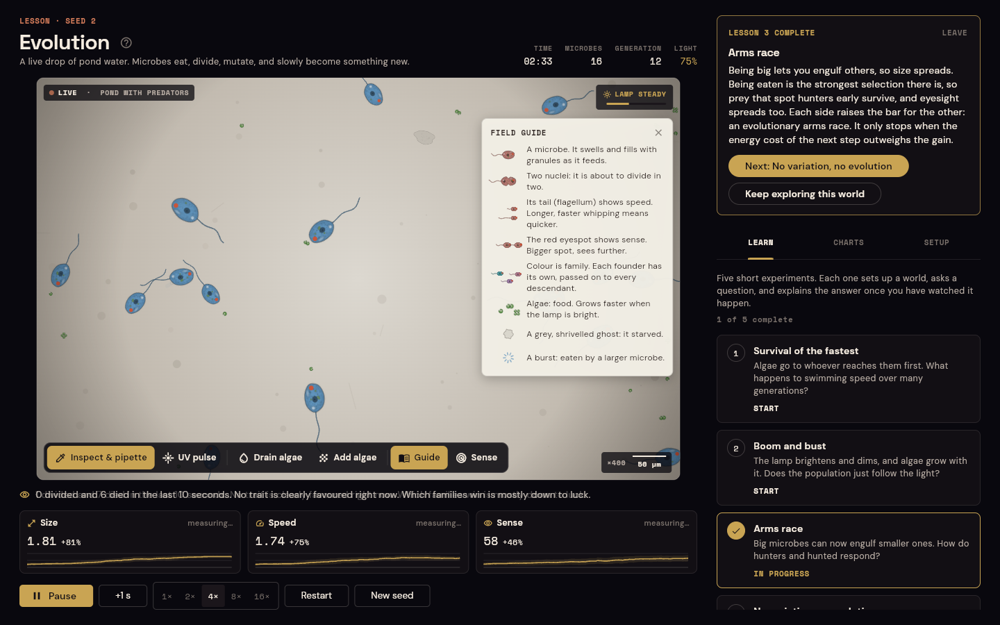

# Evolution

A live drop of pond water under a microscope, built with Flutter. Microbes hunt algae, swell as they feed, and divide in two. Their daughters inherit three traits (size, swimming speed and eyesight), each with a tiny random change. Every trait helps, and every trait costs energy. Nothing is scripted: every trend you see comes from which microbes manage to divide before they starve.

**[Open the live demo](https://chams99.github.io/Evolution/)**. It runs in the browser, with no install.


## What you are looking at

The view works like a microscope camera feed, with a live indicator, ×400 magnification and a 50 µm scale bar. A **field guide** on the slide explains every shape, drawn exactly as it appears in the drop:

- **A microbe** is a translucent cell. It swells and fills with granules as it eats.
- **Two nuclei** mean it is about to divide. When it does, you see it pinch in two.
- **Its tail (flagellum)** shows speed: longer and faster whipping means a quicker swimmer.
- **The red eyespot** shows sense: a bigger spot sees algae and danger from further away.
- **Colour is family.** Every founder cell has its own stain colour and passes it to all its descendants, so you can watch a few families take over the drop.
- **Algae** are the small green cells. They grow faster when the lamp is bright, and the lamp slowly brightens and dims.
- **Ghosts and bursts** show deaths: grey and shrivelled for starvation, a burst for a microbe engulfed by a predator.

A **caption** under the drop says what is happening in plain words, for example "4 divided and 32 died in the last 10 seconds. Smaller microbes are dividing most often right now". **Trait cards** show each trait's value, how far it has moved, and whether selection is pushing it up or down right now.

Every microbe also gets a made-up Latin name from its family and its traits, such as *Wiggula velox* (fast), *Glorbia magna oculata* (large and sharp-eyed) or *Smudgella fulminans* (lightning fast). Hover over the name to see what each word means.

## Learn by experiment

The **Learn** tab has five guided experiments. Each one sets up a sample, asks a question, tells you what to watch, tracks a live goal, and explains what happened once you have seen it:

| # | Lesson | The question |
| --- | --- | --- |
| 1 | Survival of the fastest | Algae go to whoever reaches them first. What happens to swimming speed? |
| 2 | Boom and bust | The lamp brightens and dims, and algae grow with it. Does the population just follow the light? |
| 3 | Arms race | Big microbes can engulf smaller ones. How do hunters and hunted respond? |
| 4 | No variation, no evolution | Every microbe is a perfect clone. Can anything evolve? |
| 5 | Bottleneck | A disaster wipes out most of the drop at random. What do the survivors pass on? |

Lessons run at 4× so generations pass quickly. The **favoured** and **selected against** marks on the trait cards are a standardised selection differential: how far the parents of the last 30 seconds of births sit from the population mean. Progress is saved, and a short tour runs on the first visit.

## Run the lab

- **Inspect and pipette.** Tap a microbe to follow it: its species, energy, genome, divisions, and its whole living family, circled in the drop. Tap empty water to pipette in algae.
- **Cause disasters.** Fire a **UV pulse** to sterilise a circle of the drop, **drain** most of the algae, or **add** a fresh culture, then watch who recovers.
- **Follow the families.** The Families chart (a Muller plot) shows each founder's share of the drop over time, in the same colours as the cells.
- **Catch milestones.** New generations, population crashes, families dying out ("Only 3 families left", "One family has taken over the drop") and the fate of the microbe you are following pop up on the view.
- **Compare samples.** Four samples push selection in different directions (see below), and every parameter can be tuned. The same seed always replays the same run.
- **Control time.** Play at 1× to 16×, or step one simulated second at a time. Keyboard: `Space` plays or pauses, `→` steps, `R` restarts, `1` selects inspect and `2` the UV pulse.
- **Keep the data.** Copy the full history as CSV, with one row per simulated second.
- **Share a run or a lesson.** `?preset=hunters&seed=3&at=240` opens the predator sample with seed 3, four minutes in. `?lesson=bottleneck` opens a lesson directly.

## The model

The world is 960 × 600 µm. On every tick, each microbe:

1. **Looks around** within its sense radius. If predation is on and something at least 1.3× its size is nearby, it turns away. Otherwise it turns toward the closest alga (or smaller microbe), or wanders.
2. **Swims** at its speed, turning at most 0.3 rad per tick.
3. **Pays energy**: `basal · size² + move · size² · speed² + sense · radius`.
4. **Divides in two** when its energy reaches `150 · size²`. The daughter takes half the energy and a copy of the genome with independent Gaussian mutations (7% standard deviation by default).
5. **Dies** when it runs out of energy, reaches its lifespan, is engulfed, or is caught in a UV pulse.

Cells below size 1 can only digest part of each alga. Without that rule, shrinking would always win. Algae appear at a rate that rises and falls with the lamp's sine-wave light cycle.

| Trait | Helps | Costs |
| --- | --- | --- |
| Size | Digests whole algae, stores more, can engulf microbes 1.3× smaller | Every movement costs more, and dividing needs more energy |
| Speed | Reaches algae first, outswims predators | Cost grows with the square of speed |
| Sense | Finds algae and threats from further away | A constant drain, proportional to radius |

### What the samples do

These results come from [`tool/balance.dart`](tool/balance.dart): 10 simulated minutes, seeds 1 to 3.

| Sample | Setup | Typical outcome |
| --- | --- | --- |
| Pond | Steady algae, gentle light cycle | Size stays near 1, speed and sense creep up |
| Drying puddle | Scarce algae, long dim spells | Numbers crash every cycle, speed stays low |
| Algae bloom | Algae everywhere | The largest populations, and the fastest rise in speed |
| Predators | Big microbes engulf small ones | Size, speed and eyesight escalate together |



## Design

**One colour system**, defined in [`theme.dart`](lib/app/theme.dart), where every colour has a single job:

| Role | Colour | Used for |
| --- | --- | --- |
| Neutrals | warm ink, cream, muted greys | the interface, and the slide, which is warm ivory so the live view matches the panels |
| Accent | gold | buttons, selection and trait data, and nothing else |
| Alert | terracotta | deaths, crashes and the UV pulse |
| Life | one algae green | algae, on the slide and in the charts, and nothing else |
| Data | eight family stains | equal OKLCH lightness (0.57) and chroma (0.105), hues spread around the wheel with green skipped, so no family looks louder than another and none can be mistaken for algae |

Traits are told apart by icon and label rather than by competing colours.

**Rendered figures.** The microbes and algae are illustrations rendered by [`tool/render_sprites.py`](tool/render_sprites.py): brightfield-style cells with a dark membrane and a refractive rim, granular cytoplasm, a nucleus with its nucleolus, a contractile vacuole and food vacuoles holding eaten algae. Each cell has three states (hungry, fed, dividing), and algae come as single *Chlorella*-like cells, pairs and four-cell colonies. Bodies are rendered in greyscale and tinted with the family stain on the GPU. They are drawn with `Canvas.drawAtlas` from full-, half- and quarter-size sheets, whichever is closest to the on-screen size, so hundreds of cells stay smooth and fast.

## How it is built

```
lib/
  sim/            The simulation, in plain Dart with no Flutter imports
    world.dart        Rules: sensing, movement, metabolism, division, death, families
    genome.dart       Traits, limits and mutation
    spatial_grid.dart Bucket grid for neighbour queries
    rng.dart          Seeded random source, so every run can be replayed
    sample.dart       Per-second statistics and CSV export
  app/            The interface
    lab_controller.dart  Runs the world on a fixed timestep; tools, milestones, insight
    lessons.dart         The five experiments and their goals
    microbes.dart        Family colours and Latin names
    lab_screen.dart      Side-by-side layout on wide screens, tabs on phones
    widgets/             Microscope view, field guide, charts, panels, lessons, tour
test/
  sim/            Determinism, bounds, food, division, predation, light cycle, disasters, selection, families
  app/            Every lesson completes with its seed; names; layouts at phone, tablet and desktop sizes
tool/balance.dart Headless runner used to tune the energy model
```

The engine never imports Flutter, so the tests, the balance tool and the app all run exactly the same rules. The microscope view repaints from a `ValueNotifier` on every frame, and the charts redraw only when a new sample arrives, once per simulated second. Ten simulated minutes run headless in one to four seconds, depending on population size.

## Run it locally

Requires Flutter 3.41 or newer.

```sh
flutter pub get
flutter run -d chrome        # or any connected device
flutter test
dart run tool/balance.dart   # optional: sample outcomes over 600 simulated seconds
```

## Credits

Space Grotesk, DM Sans and Space Mono are used under the SIL Open Font License. The licence texts are in [`assets/fonts`](assets/fonts).

Released under the [MIT License](LICENSE).
